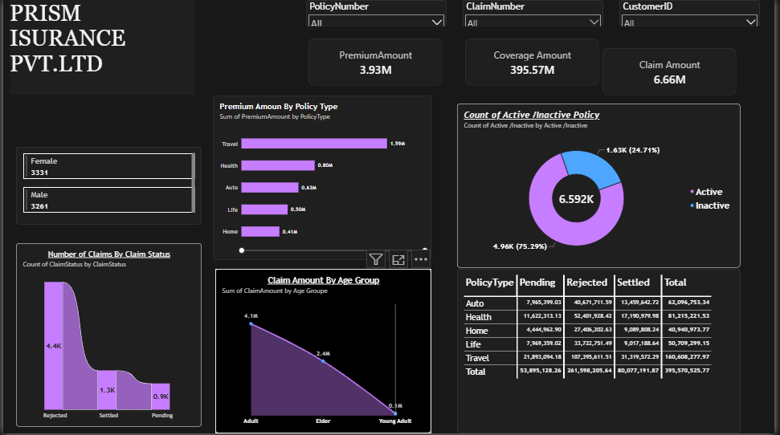

# PRISM Insurance Analytics Dashboard

## Project Overview

This project is an interactive dashboard created using Power BI to analyze insurance data

It helps users understand premium amounts policy coverage and claim performance through charts and key metrics

## Dashboard Preview

## Key Metrics

- Total Premium Amount 3.93M
- Total Coverage Amount 395.57M
- Total Claim Amount 6.66M
- Policy Records 6.592K

## Dashboard Features

- Premium analysis by policy type
- Active and inactive policy analysis
- Claims by status
- Claim amount by age group
- Policy type comparison
- Filters for policy number claim number and customer ID
- Gender wise customer analysis

## Tools Used

- Power BI
- Power Query
- DAX

## Skills Demonstrated

- Data Cleaning
- Data Analysis
- Data Visualization
- KPI Reporting
- Dashboard Development
- Business Intelligence

## Project Objective

The goal of this project is to convert insurance data into useful insights and present them in a simple visual format

The dashboard helps users compare policy types and understand claim patterns

## Future Improvements

- Monthly claim trend analysis
- Claim settlement time analysis
- More detailed business insights
